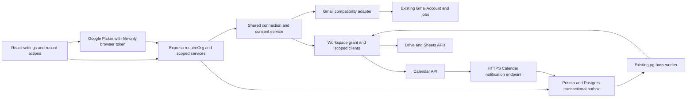
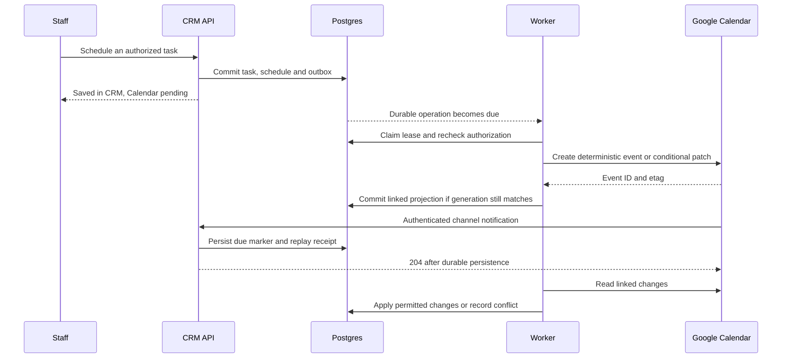

# Recommended architecture

Proposal, 25 October 2026. Model names/endpoints below describe future work, not deployed capability. Requirements and source uncertainty are in [02](02-google-requirements.md); approval choices are in [09](09-decision-log.md).

## Shared service, explicitly separated grants

Use one `GoogleConnection` application interface for identity, capabilities, health, consent, refresh, local disable and audit. New Calendar/Drive/Sheets share a **Workspace grant profile** with incremental scopes. Existing Gmail remains a **Gmail grant profile** exposed through a compatibility adapter over `GmailAccount`; retain its callbacks, table, send/sync consent versions, encrypted envelope context and jobs. Google sign-in remains a third, identity-only flow.

Prefer separate Google Cloud projects for Workspace and Gmail/login grant boundaries, subject to operator confirmation. Different client IDs in the same project do not isolate revocation. Do not move an existing Gmail deployment's client/project or force reconnection as an incidental refactor. If those already share a project, document the blast radius and test it before deciding on a later migration. A unified Connect Google screen may legitimately trigger more than one consent journey; do not promise a single universal token.

Use `google-auth-library` already installed and small typed-by-contract provider wrappers around HTTPS. Do not add the entire Google client bundle to the browser. Extract common server envelope/refresh/OAuth helpers only behind regression-tested adapters; no credentials in DTOs, events or jobs. Reuse Neon/Postgres connection conventions and pg-boss; no Redis, service account impersonation, new hosted queue or database provider.

### OAuth and browser boundaries

POST start takes an allowlisted feature, desired account and return route. Server derives tenant/user/session, exact scope delta and grant profile; a caller cannot request arbitrary scopes. Persist 10-minute one-use hashed state, browser binding, PKCE verifier encrypted at rest, nonce, allowed feature and current consent version. Callback consumes once, verifies original live session/membership/current switches, exchanges code and validates subject/client/audience/nonce/email verification and granted scope set. Partial grant enables only supported capabilities. Linking a different subject requires explicit account-switch confirmation and pauses dependent jobs.

Missing refresh token on a same-subject/client reconnect can retain a valid stored token; a new grant requires offline access. Refresh is serialized by a leased database claim plus generation fence and short-lived memory cache; stale workers cannot write a token or provider change after disconnect. Access tokens are never stored in localStorage. Picker gets a separate online **file-only** token from a same-project flow (`include_granted_scopes=false`, returned-scope check), never a broad server union token; UI cleans it from memory on close/switch/sign-out. A bound selection session connects the chosen IDs to backend validation, not to untrusted client URLs.

## Proposed data model and constraints

Every tenant-owned table has UUID id, `organizationId`, created/updated timestamps and a tenant-first access index. References use `(organizationId, id)` composite foreign keys where possible, with unique parent `(organizationId,id)`. Nullable user ownership never bypasses membership. The existing polymorphic record-reference pattern requires service-level existence and visibility checks; it is not a substitute for a foreign key. Avoid indexing access/refresh tokens or raw customer text.

| Model | Important fields / relationships | Uniqueness and indexes |
|---|---|---|
| `GoogleConnection` | org, user, verified subject, display email, profile, OAuth project alias/client fingerprint, status, generation, grantedScopes, lastErrorCode, lastSuccessAt, nextAttemptAt, legacyGmailAccountId **or** new encrypted credential envelope/wrapped key/version, refresh lease | `(org,id)` unique; active `(org,user,profile)` unique for one account/profile initially; `(org,status,nextAttemptAt,id)`; `(org,user,id)`; protected subject/project fingerprint for revocation coordination. Legacy adapter keeps one credential source, never duplicate plaintext. |
| `GoogleServiceConsent` | org/connection, service, consentVersion/at, enabledAt, disabledAt, requested/accepted capability flags | `(org,connection,service)` unique. A returned scope is not consent to enable an inactive feature. |
| `GoogleOAuthState` | org/user/original session/profile/feature, hashed state/browser, encrypted verifier, nonce, return route, expiry/usedAt | globally unique state hash; expiry cleanup index; no token/code in logs. |
| `GoogleWorkspaceSettings` | org, calendarEnabled, driveEnabled, sheetsEnabled, exportsEnabled, allowed sync roles, sanitized retention settings | one row/org; default feature flags off. Admin disables take effect before the next provider action. |
| `GoogleCalendarLink` | org/connection, calendarId, dedicated/primary mode, timezone, enabled types, direction, sync token, baseline/page cursor, nextPollAt, lease/generation, status | `(org,connection,calendarId)` unique; `(org,status,nextPollAt,id)` plus bounded global due scan `(status,nextPollAt,id)`. |
| `TaskCalendarSchedule` | org/task, explicit start/end instants or date-only start/end-exclusive, IANA timezone snapshot, chosen duration, invitation approval, location, minimal title policy | `(org,task)` unique; nonempty timed interval or valid date interval, not both. Existing Task due/reminder semantics retained. |
| `CalendarEventLink` | org/task/calendarLink, opaque operation UUID, deterministic provider eventId, etag, organizer identity, projected version/hash, last common state, dirty/conflict/cancel status, conference requestId/Meet URL/status | `(org,calendarLink,eventId)` and `(org,task,calendarLink)` unique; `(org,status,nextAttemptAt,id)`. Soft tombstones prevent event recreation after external deletion. |
| `GoogleWatchChannel` | org/calendarLink, random channelId, token hash, expected resourceId, pending/active/retiring state, project/profile generation, expiry/renewAt, limited seen-message keys | unique channelId; `(org,calendarLink,status)`; `(status,renewAt,id)`; replay receipts unique channel/message with TTL. Never trust tenant IDs supplied in a push. |
| `SheetExport` | org/actor/connection, idempotency key/request hash, entity/report type, validated filters/columns, selected file and numeric sheetId, operation status, deterministic destination tab/range, cursor, row count and timestamps | `(org,actor,idempotencyKey)` unique; `(org,actor,createdAt,id)`; provider-file operation association prevents duplicate new sheets after timeout. |
| `SheetSync` | org/owner/connection, direction (`outbound` or `inbound`), spreadsheetId/numeric sheetId, schema fingerprint, columns/mapping revision/options, cursor, schedule/timezone/nextRunAt, lease/generation, status | `(org,id)`; `(org,status,nextRunAt,id)` and global due scan; enforce one active writer per destination tab across known connections, not merely per owner. |
| `SheetRowMap` | org/sync, opaque row key, record ID, row hash/last projected version, observed row index (hint only), import action/status | `(org,sync,rowKey)` unique; `(org,sync,recordId)` as appropriate for outbound; `(org,sync,status,id)`. No row-number-only identity. |
| `SheetImportRun` | org/sync, source schema revision, bounded snapshot File/ImportJob link, per-row keys and durable processing checkpoint | unique run operation key; existing ImportJob rules transform and validate the snapshot. Snapshot retention/expiry reuse file safety and cleanup. |
| `DriveFileLink` | org/record type/id, connecting account, Drive fileId/resourceKey if needed, safe name/mime, webViewLink, observed modified/version/access state, attachedBy/at | `(org,entityType,entityId,connection,fileId)` unique; `(org,entityType,entityId,createdAt,id)`; separate from File/FileLink. Store thumbnail only if justified; never treat signed thumbnail URLs as permanent public assets. |
| `DriveSaveOperation` | org/actor, existing File ID, selected parent folder, provider fileId if known, request hash, idempotency key, status and attempts | `(org,actor,idempotencyKey)` unique; operation ID in Drive appProperties for reconciliation. No blindly repeated create/upload. |
| `GoogleSyncLog` | org/service/operation, connection, actor/record refs when authorized, status/reason code, counts, timings, retryAt | `(org,service,createdAt,id)` and `(org,connection,createdAt,id)`. No cell contents, event descriptions, file bodies or OAuth responses. |
| `GoogleRevocationOutbox` | encrypted minimal credential/envelope context and project/subject fingerprint; requestedAt, nextAttemptAt, attempts, lease, expiry | Privacy worker-owned; must survive deleting the operational connection/tenant long enough to process revocation. Avoid the existing cascading-organization-FK trap. Strict access controls and hard retention cap, then cryptographic erasure. |

Use check constraints for direction/state/type invariants and tenant-composite references. Standard indexes suffice on new empty tables. Any added index on large existing Task/Activity tables must be planned separately with `CREATE INDEX CONCURRENTLY` outside a transaction, invalid-index recovery and a rollback script. No eager update/backfill of all leads or mailboxes. On an isolated synthetic local DB or schema-only Neon branch: apply, down/up, repeat backfills and verify constraints. Production rollback is first feature flags/workers off and compatible application rollback; preserve user mappings/consent history. Do not drop populated tables to “roll back” data.

## Calendar write flow and conflict rules

1. User schedules an eligible Task explicitly. Existing unscheduled/all-day deadlines are not automatically exported. Choose start/end, timezone, calendar, optional guests/Meet and explicit invitation notice. For newly scheduled meetings `Task.dueAt` represents the scheduled start; explain this on the form and keep `TaskCalendarSchedule` authoritative for duration. Legacy deadlines retain existing meaning until the user chooses Schedule.
2. Commit CRM task + schedule + pending projection/outbox atomically. Show “Saved in CRM; Calendar pending.” Provider calls run outside the database transaction.
3. Worker reloads membership, current task/record visibility, assignee connection, tenant feature flags/plan and generation. Derive a deterministic Calendar event ID from the operation's opaque UUID using allowed base32hex characters; do not expose record identifiers in provider metadata. On create timeout/409, get that exact event and verify its opaque link before retrying. Stable request ID separately dedupes Meet creation.
4. Patch only owned fields with `If-Match`; retain provider-only fields. 412 triggers a reread, not blind overwrite. Store last common values, local task version and last applied projection hash.
5. CRM wins for record binding, organizer and approved attendee list. In two-way mode Google can change linked event start/end/location or cancel it. A non-overlapping change merges; simultaneous changes to the same field produce a visible conflict needing a user's resolution. Do not use whichever computer clock happens to be later.
6. External deletion marks the link tombstoned and cancels the scheduled task with a system timeline entry in two-way mode; it never deletes a lead. In one-way mode show external removal and require an explicit recreate action. Completion keeps the historical event; CRM cancellation/deletion removes/cancels its linked event using the previously approved guest-notification policy. Record soft deletion cancels future linked scheduling; unrelated events are untouched.
7. Reassignment requires the new assignee's own grant and explicit organizer/invite handling; do not “transfer” a provider event merely by changing a CRM owner. Pause pending transfer until approved; keep an auditable old/new event mapping to avoid duplicate invitations.

Push marks a selected calendar due; a durable 5–15 minute jittered polling fallback runs even if no pushes arrive. Dedicated-calendar collection sync stores only mapped CRM event fields and discards unlinked entries immediately. Do not pair a private-property filter with syncToken. Primary-calendar mode uses known-event-ID reads, with bounded pages and fair scheduling, to avoid copying a personal calendar. 410 rebaselines only sync/cache state and retains CRM links/tombstones. Initial and recovery scans have limits and resumable cursors; stop with a visible delay rather than consuming unbounded quota.

UTC instants plus an IANA timezone are stored for timed events; all-day dates remain date-only with exclusive end. Derive old all-day dates in their original workspace timezone, never the browser zone. New scheduler can use `User.timezone ?? Organization.timezone ?? Asia/Kolkata`, displays its zone explicitly and stores a snapshot. Shared legacy Task/Today views must either use the workspace zone or display a clear conversion; changing user timezone cannot silently move a task. Reject DST gaps; require explicit earlier/later occurrence for ambiguous times. Phase 1 mirrors each CRM-generated recurrence occurrence as a single event; it does not also create an RRULE series.

CRM owns staff reminders by default; set Calendar reminder overrides empty. User may switch to Calendar reminders for that scheduled item, atomically suppressing the corresponding CRM reminder. Invitee-controlled calendar alerts cannot be suppressed by TechSync; disclose this limit. RSVP is informational, not task completion. Free/busy is checked just before save and local overlapping scheduling can be constrained under a DB lock, but Google/external writers can race; do not promise globally atomic double-booking prevention.

## Sheets: bounded, directional workflows

**On demand:** require `records.export` **and** the relevant entity read scope or report's `reports.read` scope, current filters and columns; recheck while paging. Existing report exports deliberately require both report access and export permission. Create a new spreadsheet or a new TechSync-owned tab in a Picker-selected file. Never clear an arbitrary existing range. Persist idempotency/operation before writes. For newly created spreadsheets use a supported Drive creation/appProperties strategy with returned spreadsheet ID, or reconcile the unique operation marker before retry; prove same-project `drive.file` authorization in the provider spike. If an uncertain create cannot be conclusively reconciled, leave it Unknown for reviewed recovery instead of creating another file. Header formatting and RAW writes are batched. Neutralize external text starting with whitespace/controls then `= + - @`; keep authorized identifiers as text and use exact safe money conversion. Report snapshot includes range/timezone/as-of metadata. Existing XLSX/CSV exports still work if Google fails.

Campaign is not a current `transferEntity`. Add a bounded, explicit campaign export projector over the existing campaign visibility/query service, with `records.export` plus `campaigns.read` and team export constraints; do not pretend the lead/contact/company/deal export allowlist already supports it. Report types/columns likewise remain allowlisted. For snapshot consistency use an as-of boundary/stable paging; do not label a changing live scan as an immutable point-in-time database snapshot.

**Outbound live:** subscribe to CRM outbox IDs, coalesce rapid changes and recheck the sync owner's current export/record scope. Managed tab has opaque `_techsync_row_key` and record-version columns; those columns are not security controls. Resolve row keys to current positions before updates, detect duplicate/missing keys and pause on structural drift. Developer metadata may help, but row number is never authoritative. Only CRM-owned columns are overwritten; user notes live in separate columns/tabs. Scope loss or record deletion removes app-owned rows when authorized to the destination and pauses further exports; existing external copies cannot be recalled or guaranteed erased. Every export setup explains this.

**Inbound lead source:** owner/admin explicitly selects a sheet/tab and completes the reused mapping/options/full preview. Pilot polling every 15 minutes, bounded to the existing 50k-row import limit and row/cell bounds. Require an immutable `_techsync_source_id` column assigned during reviewed setup with explicit sheet-write permission. If writes are unavailable, require a customer-provided stable source key; do not substitute row position or a content hash. Sheet reordering/insertion preserves identity; duplicate/blank keys are row errors. Content hashes detect edits; row key maps prevent duplicate creates. Manual key changes/copying require review and are outside any stable-key retry guarantee. Snapshot is an immutable ImportJob input, tagged source/sync/run, and existing validation/dedupe/plan/owner/source rules apply. Choose and test explicit Sheets value/date rendering and locale handling; do not assume Google date serials use the Excel importer epoch/calendar quirks. Updates require a reviewed option and allowlisted intake fields; blank/deleted source rows never delete CRM records. Rejected rows expose safe field errors and source row references; optional writeback is confined to named CRM-status columns. No arbitrary formulas execute in the importer.

The two directions cannot target the same managed tab. No general same-cell two-way sync. Enforce one active managed writer with a protected destination fingerprint (project, spreadsheetId, numeric sheetId), including known cross-workspace bindings; a generic destination-in-use response must not disclose another tenant. Outbound filtering changes can trigger bounded reconciliation, not an unbounded rescan. Scheduled reports use a daily/weekly schedule row and UTC nextRunAt computed from saved IANA timezone; dedupe by schedule/local-period key, recheck permissions each run, skip/notify on a removed owner. Build a small Sheets report-delivery schedule or explicitly depend on the still-unfinished M15 scheduler; do not assume one exists.

## Drive: reference first

Picker selects files/folders; server validates file ID, granted account, mime/capabilities, trashed state and current CRM record access. Store minimal authoritative metadata and allowlisted Google URLs, not client-provided HTML or arbitrary preview URLs. Linking a Drive file neither copies its bytes nor changes permissions. A teammate may see authorized link metadata but Google remains the content access gate; offer Open in Drive / Ask owner for access. Do not automatically probe a teammate's access using the original connector's credential or proxy file bytes to bypass Google permissions.

Default saves are explicit copies of an existing authorized CRM File into a folder owned/selected by the employee. Use opaque record IDs in auto-generated folder names by default. Preserve S3 original, file sniffing, tenant quotas and existing links; do not migrate/delete objects for “cost savings.” Recheck source-file access and destination capabilities in the worker. Store operation marker; reconcile ambiguous upload/create before retry. Shared drives, ownership transfer, permission mutations and public-link sharing are separately approved advanced features. Moving a file does not change its identity; deleted/trashed/no-access files show stale/unavailable and can be unlinked locally without trying to delete the external file.

## API surface (proposed)

All `/api/google/*` routes use requireOrg and service-level authorization except the state-bound callback. IDs are opaque; pagination is bounded. Preserve existing Gmail, `/files`, `/imports`, `/exports` and report contracts.

| Route | Authorization / contract |
|---|---|
| `GET /api/google/connections/me` | Own status/capabilities/settings DTO; no secrets. |
| `POST /api/google/oauth/start` / `GET /api/google/oauth/callback` | New connect permission + tenant feature gate / state-session-PKCE binding. Return only safe UI status. |
| `PATCH /api/google/connections/:id/services/:service` | Own capability toggle or admin local disable; disabling does not claim provider scope revocation. |
| `POST /api/google/connections/:id/disconnect` | Local workspace detach; return affected operations only within current tenant. |
| `POST /api/google/connections/:id/revoke-project-grant` | Own Google identity, explicit project-wide warning/recent auth; durable revoke. No cross-tenant metadata disclosure. |
| `GET /api/google/admin/connections`, `GET /sync-logs`, `GET/PATCH /settings` | Owner/admin; metadata only, pagination, audit. |
| `GET/PUT /api/google/calendar/settings` | Own active Calendar grant; optional calendar list only when granted. |
| `POST/PATCH/DELETE /api/tasks/:id/calendar-event` | Current Task update/read + record access + assignee grant; schedule/pending operation or cancel. No provider calendarId injection. |
| `POST /api/google/calendar/availability` | Own allowed calendars/time window, free/busy capability; no unrelated event content. |
| `POST /api/google/calendar/conflicts/:id/resolve` | Authorized scheduler; expected version and chosen fields. |
| `POST https://crm.techsynchronic.com/api/webhooks/google/calendar` | Public channel verification and durable due mark; fast 204, never bearer-auth middleware. |
| `POST /api/google/picker/session` | Current membership/feature/record action; no-store file-only browser authorization, short selection-session TTL. |
| `GET/POST/DELETE /api/records/:entityType/:id/drive-links[/:linkId]` | Current record read/update, attachment permission, validated connection/file ID. Local unlink only. |
| `POST /api/google/drive/save`, `GET /operations/:id` | Source File access + destination capability; idempotency key; actor-scoped operation. |
| `POST /api/google/sheets/exports`, `GET /exports/:id` | Existing export/report scope, filters/columns, destination selection and idempotency key. |
| `GET/POST/PATCH /api/google/sheets/syncs[/:id]` | Owner/admin/approved manager for outbound within team; owner/admin import permission for inbound. |
| `POST /api/google/sheets/syncs/:id/preview`, `/start`, `/pause`, `/retry` | Revision-bound reviewed mapping, current permissions, audited run. |

New permission proposals: `google.connect.own`, `google.connections.manage`, `google.settings.manage`, `calendar.schedule.own/team/all`, `drive.attach`, `drive.save`, `sheets.sync.manage.team/all`; compose with existing record permissions, `records.import`, `records.export.*`, `reports.read.*`. Viewer gets no connection/export/scheduling; can open an authorized record's link via Google. Reps can attach/schedule own records but cannot bypass bulk export by creating a Sheet sync. Manager inbound ingestion stays disallowed unless product explicitly changes current import permission.

## Workers, failures, privacy and departure

Add `google.calendar.write`, `.pull`, `.renew`, `google.drive.save`, `google.sheets.export`, `.outbound`, `.inbound`, `.report`, and `google.maintain` handlers to existing queues/schedules. Jobs carry org/operation IDs only. DB due state is authoritative; a minute scan requeues stranded operations. Leases expire, writes use version fences, retries have jitter and caps; after repeated permanent/unknown failure show an actionable failed/dead-letter state with an audited retry. No automatic replay of an uncertain invitation/copy/append.

| Condition | Required behavior |
|---|---|
| Google/network unavailable | Keep CRM save, display Pending/Delayed + last success; persist retry time, never show falsely connected/synced. |
| `invalid_grant` / admin block | Needs reconnect or Blocked by Google admin; pause dependent jobs, preserve mappings and user drafts. |
| Quota exhausted | Delayed with next attempt; fair user/project budgets; no busy retry loop. |
| File/tab/calendar deleted | Mark unavailable/schema changed; require explicit replacement destination/review; never silently create a different target. |
| Membership/role/plan changes | Worker rechecks; local disable atomically increments generation, cancels pending actions and pauses syncs. |
| KMS/key unavailable | Fail closed, generic setup error; no plaintext/alternate-email fallback. |
| Worker dies after provider success | Reconcile deterministic event ID / operation marker / stable sheet row key before another write. |

Local service off stops usage and erases unneeded per-service caches; it cannot selectively revoke Google's project grant. Local workspace detach removes that binding's credentials/work; other legitimate workspace bindings may remain. Actual project-grant revocation is explicit and invalidates all matching app project grants; an internal security worker marks affected bindings reconnect-required without exposing other tenants. For last-known bindings, departure/tenant deletion can enqueue revocation; for shared identities with other active bindings, detach locally rather than inadvertently disabling unrelated tenants. This policy needs approval and a cross-workspace test.

Default proposed retention: OAuth state 10 minutes; replay receipts 7 days; routine sync logs 30 days; failed-row snapshots 7 days; minimal audit IDs/status 180 days subject to the existing tenant policy. No whole-calendar, unrelated sheet, Drive content or clinical-text cache. Delete credential material immediately on local detach except an encrypted, tightly restricted revocation payload retained at most 30 days; purge it after success/expiry. Tenant deletion purges local mappings/content and finishes detached revocation independently. Do not delete Google files/events automatically on disconnect; offer a separate pre-disconnect cleanup of app-created resources with explicit confirmation and idempotent accounting. External copies/invitations remain under Google/customer control.
