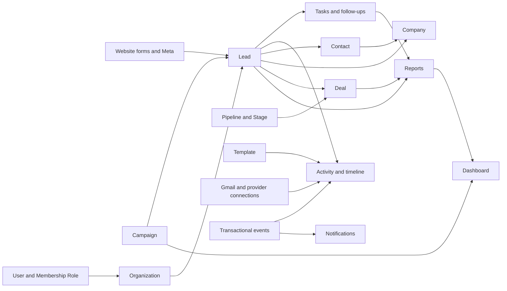

# System map

## Runtime and request path

`frontend/src/router.tsx` lazily loads CRM pages under AppLayout; RootShell coordinates auth, workspace and errors. `services/http.ts` owns fetch, memory-only access tokens, httpOnly rotating refresh, expired-token retry and API envelopes. TanStack Query keys include workspace IDs; URL filters, reusable DataTable/DataGrid, UserPicker, custom fields, dialogs/drawers, toast and state components are shared. Forms use Zod + react-hook-form or existing inline validation. Tailwind 4/CSS tokens supply shared surfaces/controls; mobile tabs expose Home, Leads, Pipeline and Tasks.

`backend/src/server.js` starts Express, mailer verification, notification listener and producer queue. `app.js` applies request IDs, safe structured logging, Helmet, CORS, compression, bounded body parsing and API rate limiting. `routes/index.js` mounts validators/controllers/services. `requireOrg` verifies JWT, reloads active user/membership/workspace on every request, checks verification/deletion/seat restrictions/required 2FA, and resolves manager team IDs. `permit` is a coarse server gate; `visibilityWhere`, `canAccessRecord`, record references and tenant predicates enforce row access. Staff/superadmin paths use separate staff middleware and are outside customer modules.

Prisma 7 + `@prisma/adapter-pg` owns schema and queries. `prisma7.config.ts` uses direct migration URL; normal API uses pooled pg with strict TLS. `versionedUpdate` protects optimistic concurrency. Services write domain events/audits in the same transaction as relevant changes. `events/dispatcher.js` leases/retries events; subscribers handle timeline/assignment/scoring/notifications. There is no new ORM, queue, UI library or provider.

`worker.js` + `jobs/schedules.js` run pg-boss handlers for import/export, files, email, Gmail sync, Facebook delivery/deletion recovery, token expiry, reminders, digests, lead assignment/SLA, trial maintenance, scoring, deal rot and soft-delete purge. Worker jobs intentionally scan across organizations, then operate on explicit tenant records; they must not be mistaken for customer API access. Delivery side effects require independent idempotency and permission rechecks.

Storage adapters use existing S3/files services, signed uploads, quarantine/promotion and links. Imports have bounded CSV/XLSX parsing, mapping, preview, duplicate handling, durable execution and undo. Exports use safe spreadsheet cells and permission scope. No production storage/provider credentials were used for this review.

## Connections

## Shared entities and ownership

| Entity | Relationships / key conventions |
|---|---|
| Organization/Tenant | Workspace currency, timezone, country, locale, plan/security; memberships resolve roles |
| User/Role | Owner/admin/manager/sales_rep/viewer; manager team scope; global user can join several workspaces |
| Lead | Unqualified enquiry, source/campaign/UTM, status, ownership, scoring/qualification, conversion IDs, soft deletion |
| Contact/Company | Many-to-many via ContactCompany; emails/phones and lookup tables; company GST/address; scoped links |
| Campaign | Own lifecycle (M22), budget/spend/currency, lead attribution; does not replace lead source or first-touch UTM |
| Deal/PipelineStage | Stage type open/won/lost determines deal lifecycle, required fields, probability/history; money in minor units |
| Task | Assignee plus creator visibility, polymorphic lead/contact/company/deal, recurrence/reminders, completion activity |
| Activity | Primary record plus ActivityLink timeline, actor/participants/mentions; sourceEventId prevents replay duplicates |
| Template | Existing EmailTemplate extended by inherited work for email/WhatsApp/SMS, personal/shared, variables/archive |
| Integration | Gmail user mailbox/OAuth/sync; Meta Page/form mappings/deliveries; WebForm submissions and assignment rules |
| Report | Aggregated views of real records, no independent demo facts; cohort/closure/time/currency definitions explicit |
| Audit/DomainEvent | Audit for sensitive actions; event outbox retained and tenant/entity-indexed; existing events provide funnel progress |

Full entities/declared indexes: [schema inventory](SCHEMA-INVENTORY.md). SQL-only indexes: migrations 20261022173000, 20261024010000, 20261025090000–090200 and report period index migration. Existing tables use organization_id first in common CRM indexes; unbounded related presentation/config lists remain scale concerns. No RLS claim is made: this app relies principally on authenticated service scoping.

## Config and observability

Backend env fails fast, encrypts provider secrets and separates direct/pooled DB URLs; Gmail and Facebook remain opt-in. Worker health/heartbeat and structured request/performance logging exist. `.env` values were not printed, replaced, or used for tests. Local scripts pin the database name/host, use synthetic credentials and disable actual external providers. Frontend reports/capture/assignment no longer silently use browser previews; old preview data is not automatically uploaded.
